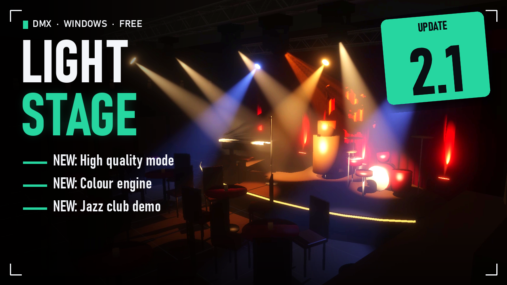

# LightStage

**Free, open-source 3D lighting visualizer and DMX controller for Windows.**

Build your stage, patch your rig and see every beam in real-time 3D, then send the same values to real lights via Art-Net, sACN or USB DMX.

## ⬇ Download

**Ready-to-run builds (Windows 10/11, 64-bit) are available here:**

### 👉 [grosserd5.gumroad.com/l/lightstage](https://grosserd5.gumroad.com/l/lightstage)

The download is free. Getting it from Gumroad means you are notified about updates. This repository contains the source code only – there are no binary releases on GitHub.

## Features

- Volumetric beams, haze, shadows, bloom – indoor and outdoor stages
- Quality levels Draft / Normal / High (floor reflections, contact shadows)
- 600+ fixtures (Open Fixture Library) plus a fixture editor
- Show **Time Line**: keyframes, cue track, snapshot and effect clips, audio track
- Sync: MIDI timecode (MTC), LTC, Ableton Link / MIDI clock
- Effect builder: LFO, step sequencer, envelope, drawn waves
- Output: Art-Net, sACN, USB DMX (DMX USB Pro protocol)
- MIDI learn, OSC for every parameter, Ableton Live bridge
- Snapshots that mix, cue list, group faders, performance mode
- MP4 export up to 4K, Resolume Advanced Output export, Lightshow export/import
- German and English interface

## Building from source

1. Install Visual Studio 2022 or the *Build Tools for Visual Studio 2022* with the workload **Desktop development with C++**.
2. Run `build.bat`.
3. Result: `LightStage.exe` in the repository folder. It needs the folders `library` and `assets` next to it.

`LightStage.exe --selftest` runs the built-in tests. More details: [README_SOURCE.txt](README_SOURCE.txt).

| Folder | Contents |
|---|---|
| `src/` | LightStage source (C++17, Dear ImGui, OpenGL 4.3) |
| `assets/` | fonts and program icon |
| `library/` | fixture library (Open Fixture Library data + generic fixtures) |
| `third_party/` | Dear ImGui, GLEW, ufbx, cgltf, stb, Ableton Link (with standalone asio) |
| `tools/i18n/` | helper scripts for the translation table |

## Versions

Every public release is tagged (`v2.0`, `v2.1`, …). The `main` branch always matches the latest release on Gumroad.

## License

LightStage is free software under the **GNU General Public License v3 or later** – see [LICENSE.txt](LICENSE.txt) and [COPYING.txt](COPYING.txt). Third-party licenses: [THIRD_PARTY_LICENSES.txt](THIRD_PARTY_LICENSES.txt).

You may use, modify and share LightStage, also commercially – but anyone who distributes it, modified or not, free or paid, must provide the complete source code under the same license.

**Name and logo:** "LightStage" and its icon identify the official builds. If you publish a modified version, please give it a different name and icon.

## Feedback

Bug reports and feature ideas are welcome in the [Issues](https://github.com/grosserd/lightstage_dmx/issues). Please always check DMX output on real equipment before a show.

---

*Deutsch:* LightStage ist kostenlos und quelloffen (GPLv3). Den fertigen Download gibt es auf [Gumroad](https://grosserd5.gumroad.com/l/lightstage), hier liegt der Quellcode.